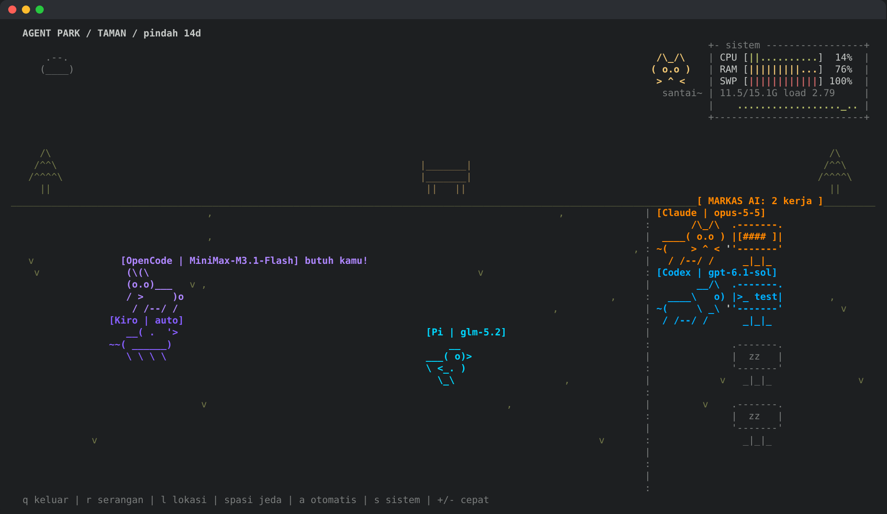
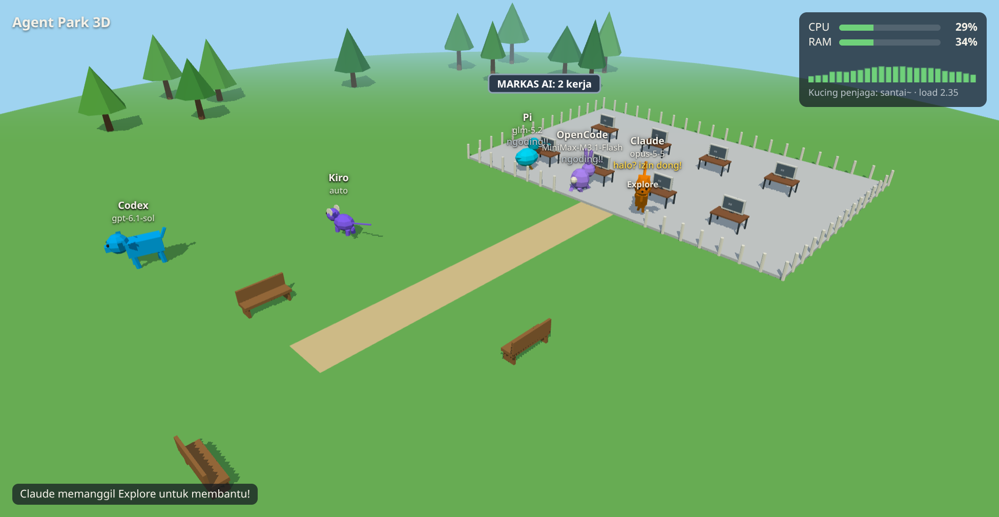

# Agent Park

The AI agents you are running (Claude Code, Codex, OpenCode, Kiro, Pi, ...)
live as animals in a park: they go to the office when working, jump when they
need your approval, and play when idle. Available as a terminal screensaver and
as a 3D app.



By default, the park is only populated by animals belonging to running
Claude Code, Codex, and OpenCode sessions (see **AI cats** below), their
children for subagents, and monsters from heavy processes. If there are no
sessions yet, the park is empty with the text `Taman sepi...`. Run with
`--semua` to also spawn the wild animals listed below.

ASCII cats, dogs, rabbits, ducks, and mice with random behavior.
Some stroll leisurely, sleep, groom themselves, jump, or suddenly dash off.
When they meet, they may greet each other, chase one another, or get into a
cartoon fight with dust clouds and POW/BONK text, then flee in opposite
directions.

New animals occasionally enter from the edge of the screen; some just pass
through and leave again. The number of animals adjusts to the screen size
(up to eight). Runs on Linux/macOS with Python 3, no extra packages.

There are four places that switch automatically every 35 seconds:

- **Park**: trees, a bench, grass, and moving clouds.
- **Forest**: rows of trees and fireflies.
- **Beach**: coconut trees, the sun, sand, and moving waves.
- **Village**: houses and a road.

Animals walk on the ground area below the scenery. Changing location does not
remove the animals or stop interactions. When paused, the countdown for
switching places also stops.

Monsters attack whenever a heavy process newly appears on the computer! All
animals, including those sleeping and those just passing through, stop their
activity to gather, block the attack with shields, then strike back together.
The monster always loses and flees; the animals celebrate their victory with
jumps and confetti before returning to their activities. No animal gets hurt.

Monsters do not appear at random. A monster is a process started after the
screensaver was opened (including a shell that `exec`s another program) that
then uses on average at least 90% of one CPU core for 3 seconds or at least
1 GB of RAM. For example, `cargo build` or a test run by an agent. The
monster's name is taken from its process name, e.g. "Monster cargo (CPU 180%)".
Processes already running before the screensaver was opened, as well as the AI
agents themselves, never become monsters. Each process only attacks once, and
after a battle there is a 30-second cooldown. The thresholds can be changed via
`MONSTER_CPU`, `MONSTER_RSS`, and `RAID_COOLDOWN`. Press `r` to trigger an
attack manually. One event lasts about 14 seconds. Location changes and the
arrival of new animals wait until the battle is over; the pause key still
works.

System panel: in the top-right corner there is a small btop-style box
containing CPU, RAM, swap (if any), load average, and a graph of the last
24 seconds of CPU. Next to it sits a guard cat. If CPU goes above 60%, the cat
starts to worry (`CPU naik nih...`). If CPU goes above 85% or RAM above 90%,
the cat panics, trembles, and shouts `AWAS! CPU 93%!`. The panel only appears
on Linux in terminals at least 64x20.

AI cats: every running **Claude Code**, **Codex CLI**, or **OpenCode** session
gets its own animal: an orange cat `[Claude]`, a blue dog `[Codex]`, or a
light purple rabbit `[OpenCode]`. For simplicity, they are all called
"AI cats" below. The provider or model used does not matter: OpenCode with
DeepSeek, Gemini, or a local model is still an `[OpenCode]` rabbit.
The second and subsequent sessions are numbered, e.g. `[Claude 2]`. Status is
read from `/proc` every second based on average CPU usage over the last
3 seconds: if the session is working, the cat runs to **AI HQ**, a fenced area
on the right side of the ground containing a row of computers. Each cat gets
its own desk, sits facing its computer, then types frantically while shouting
`tik tak tuk!`, `ngoding!!`, and the like, while its computer screen shows
`>_ make`, a progress bar, and so on. An empty computer shows `zz`. If all
desks are taken, the remaining cats run around inside the HQ. The sign above
the HQ shows how many are currently working. Once a session stops, its cat
leaves the HQ and plays in the park like the other animals (but does not join
the fights). Ordinary animals do not enter the HQ. The HQ only appears if there
are AI cats and the terminal is at least 72 columns wide; on narrow screens the
cats work across the whole park. Once a session is closed, its cat says goodbye
and walks off the screen. AI cats do not join the fights, but they do join in
fighting the monsters. This feature only runs on Linux.

Without extra configuration, the work status is only an estimate from CPU. For
accuracy, install a hook that calls `agent_hook.py`. This script writes the
session status to `$XDG_RUNTIME_DIR/agent-park/<pid>.json`, which the
screensaver then reads:

- `work`: you sent a prompt or the agent is using a tool. The cat sits at its computer in the HQ and types.
- `wait`: the agent is asking for permission. The cat jumps around with the
  label `butuh kamu!`.
- `idle`: the turn is finished or stopped. The cat leaves the HQ and plays in the park.

The hook also records the model used by the session, and that model then
appears on the animal's label, e.g. `[Claude | opus-5-5]`. The sources:

| Agent | Model source |
| --- | --- |
| Claude Code | the last reply in the transcript (`transcript_path` from the hook) |
| Codex | `~/.codex/sessions/.../rollout-*-<session>.jsonl` |
| Kiro | `~/.kiro/sessions/cli/<session>.jsonl`; Auto mode is only recorded as `auto` |
| OpenCode | sent by the plugin; its fallback is the `session_v2.model` column in the OpenCode database (opened read-only) |
| Pi | `ctx.model` from the extension, including when using `/model` or Ctrl+P |

A new model appears after that session's first hook runs. Agents without a hook
do not display a model.

AI cats do not just walk in plainly. Their entrance is chosen at random: they
fall as a **meteor** (KABOOM!), get lowered by a **UFO** with a beam, come out
of a **portal**, **parachute** in, or get **teleported** from a random
character. If a monster attacks while a cat is landing, the cat immediately
joins the defense. Subagent children appear with a "POP!" effect after their
parent has landed.

Subagents appear as **children** of their parent animal (kitten, puppy, or
baby rabbit) labeled with their type (e.g. `[Explore]`). These children run
around their parent and leave when the subagent finishes. At most 4 children
per parent. A child whose `SubagentStop` event never arrives is removed after
30 minutes.

Claude Code (`~/.claude/settings.json`), one entry per event
`UserPromptSubmit`, `PreToolUse`, `PostToolUse`, `PostToolUseFailure`,
`SubagentStart`, `SubagentStop`, `PermissionRequest`, `Notification`, `Stop`,
`StopFailure`, `SessionStart`, `SessionEnd`:

```json
{"hooks": {"Stop": [{"hooks": [{"type": "command", "timeout": 5,
  "command": "python3 /path/to/screensaver/agent_hook.py claude"}]}]}}
```

Codex CLI (`~/.codex/hooks.json`) uses the same format with the argument
`codex`, for the events `UserPromptSubmit`, `PreToolUse`, `PostToolUse`,
`SubagentStart`, `SubagentStop`, `PermissionRequest`, `Stop`, `Interrupt`,
`SessionStart`, `SessionEnd`. Approve the hook once via `/hooks` in Codex.

Codex runs hooks from a single background process (`codex app-server`) that
serves all Codex windows, so it is not known which window owns a given session.
Because of this, Codex status is stored per session
(`codex-<session_id>.json`), and Codex cats are taken from the most recent
sessions, as many as there are open Codex windows. Windows that have not yet
sent an event use the CPU estimate.

If the [ccx](../ccx) profile uses a router (`ccx-router`), a **ccx router** box
appears in the top-left. It contains the profile name, local port, upstream
host (without path or credentials), uptime, and the Claude cat using it. The
arrow `>-->` moves when the router or its cat is working; otherwise it shows
`diam` and the number of open connections. At most three routers are shown, and
the rest are summarized as `+N lagi`. A router never becomes a monster.

OpenCode has no command-based hooks, so its status is sent via the
`opencode_plugin.js` plugin. This plugin turns OpenCode session events (busy,
asking for permission or asking a question, finished) into Claude-style events,
then calls `agent_hook.py opencode`. OpenCode subagents (e.g. `@explore`)
appear as baby rabbits. This plugin supports OpenCode 1.x and 2.x. Install it
with a symlink:

```sh
mkdir -p ~/.config/opencode/plugins
ln -s "$PWD/opencode_plugin.js" ~/.config/opencode/plugins/agent-park.js
opencode service restart   # OpenCode 2.x; on 1.x just reopen OpenCode
```

Starting with OpenCode 2.x, all windows are served by a single background
process (`opencode serve --service`), and the plugin runs there. That
background process itself is not counted as a session. Like Codex, status is
stored per session (`opencode-<session_id>.json`) and shared with the open
OpenCode windows.

List of recognized agents:

| Agent | Process | Animal | Accurate status |
| --- | --- | --- | --- |
| Claude Code | `claude` | orange cat | hook (above) |
| Codex CLI | `codex` | blue dog | hook (above) |
| OpenCode | `opencode` | light purple rabbit | plugin (above) |
| Kiro CLI | `kiro-cli`, `kiro-cli-chat` | purple mouse | hook (below) |
| Aider | `aider` | green mouse | CPU estimate |
| Goose | `goose` | yellow duck | CPU estimate |
| Crush | `crush` | pink cat | CPU estimate |
| Amp | `amp` | red dog | CPU estimate |
| Pi | `pi` | light blue duck | extension (below) |
| Strix | `strix` | dark red dog | CPU estimate |

Pi runs on top of Node but renames its process to `pi`, so it is still
detected. Its status is sent via the `pi_extension.ts` extension: starting and
finishing answering a prompt (including Esc), and exiting. Pi has no built-in
permission prompt or subagents, so there is no `butuh kamu!` or baby ducks.
Install it with a symlink, then reopen Pi:

```sh
mkdir -p ~/.pi/agent/extensions
ln -s "$PWD/pi_extension.ts" ~/.pi/agent/extensions/agent-park.ts
```

Kiro CLI only supports hooks in custom agents. The safest way is to copy the
built-in agent so that all tools stay active. After that, add the `hooks`
section below to `~/.kiro/agents/agent-park.json`, validate it, then make it
the default:

```sh
EDITOR=true kiro-cli agent create agent-park --from kiro_default
kiro-cli agent validate --path ~/.kiro/agents/agent-park.json
kiro-cli agent set-default agent-park
```

An agent that only contains `hooks` may lose access to tools. Kiro event names
use camelCase, and `agent_hook.py` accepts them as-is. Kiro only has these five
events and has no event for when it asks for permission, so its animal cannot
display `butuh kamu!`.

```json
{"hooks": {
  "agentSpawn": [{"command": "python3 /path/to/screensaver/agent_hook.py kiro-cli"}],
  "userPromptSubmit": [{"command": "python3 /path/to/screensaver/agent_hook.py kiro-cli"}],
  "preToolUse": [{"command": "python3 /path/to/screensaver/agent_hook.py kiro-cli"}],
  "postToolUse": [{"command": "python3 /path/to/screensaver/agent_hook.py kiro-cli"}],
  "stop": [{"command": "python3 /path/to/screensaver/agent_hook.py kiro-cli"}]
}}
```

Other agents can be added to the `AGENTS` table in `screensaver.py` (process
name, name, animal type, color). Their animal can also be changed in that
table, e.g. `"bebek"` (duck) or `"tikus"` (mouse). A detected agent without a
hook uses the CPU estimate. The requirement is that its process name in
`/proc/<pid>/comm` must be distinctive. An agent running as a plain `node`
cannot be distinguished this way.

Claude does not send an event when you press Esc. Because of this, a `work`
status older than 90 seconds is read from CPU again.

Run from the project folder:

```sh
python3 screensaver.py          # AI cats only
python3 screensaver.py --semua  # plus wild animals
```

Enable fullscreen from your terminal application (usually **F11** on Linux).
The animation automatically follows the terminal size, including after a
resize.

| Key | Function |
| --- | --- |
| `q` / `Esc` | Quit |
| `Space` | Pause / resume |
| `+` / `-` | Increase / decrease speed |
| `n` | Bring in a passing animal, if the screen is not yet full (only with `--semua`) |
| `l` | Move to the next location |
| `r` | Trigger a monster attack; all animals cooperate until they win |
| `a` | Toggle automatic location switching (stay in the current place) |
| `s` | Show / hide the system panel |
| `Ctrl+C` | Quit |

On exit, the terminal display and cursor are restored to how they were. This is
a manually run animation; it is not yet connected to the system screensaver
settings.

## Agent Park 3D



`park3d/` contains a 3D version of this park as a desktop app
([Tauri](https://tauri.app) with Three.js). The terminal can still be used as
usual. The agent detection logic stays in Python: the app runs
`park_state.py`, which prints the park status as one line of JSON per second
(agents, subagents, CPU/RAM, monsters), and the 3D world then moves its own
animals based on that status. New agents only need to be added to the `AGENTS`
table, and both views get them right away.

```sh
cd park3d
pnpm install
pnpm tauri dev                 # run while developing
pnpm tauri build --no-bundle   # binary: src-tauri/target/release/park3d
```

Display options, as app arguments (`park3d --low --fps`) or in the browser URL
(`?low&fps`):

| Option | Function |
| --- | --- |
| `--low` | No shadows or antialiasing, 1× resolution. Lightest |
| `--fps` | Show FPS and draw call count in the top-left corner |
| `--cap=N` | FPS cap (default 30; `--cap=0` for no cap) |
| `--smooth` | 60 FPS, same as `--cap=0` |

Requires Rust, Node, pnpm, and `webkit2gtk-4.1`. `python3 park_state.py --once`
shows a single status snapshot, and `pnpm dev` followed by opening
`http://localhost:1420/?demo` shows the 3D world with sample agents in a regular
browser. On Wayland, the app sets `WEBKIT_DISABLE_DMABUF_RENDERER=1` so that
WebGL is not black. The location of the status script can be changed via
`PARK_STATE`.

Test the interaction simulation, passing animals, and resize with:

```sh
python3 -m unittest -v
```
